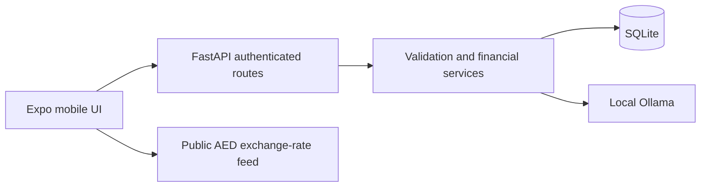

# System architecture

[Mobile/App.tsx](../Mobile/App.tsx) owns screen-state navigation and supplies the API base URL. Welcome, Login and Register precede Home. Main tabs expose Home, Transactions, AI Chat, Financial Plans and Insights; dashboard links open Budget Tracker, Spending, Debt, Savings and Settings. This navigation uses component state rather than Expo Router.

Screens and components live in `Mobile/src/screens` and `Mobile/src/components`; styles and theme hooks supply the shared appearance. Theme preferences persist locally and default to dark. Language menus have broader coverage than translated financial content; English, Arabic and Mandarin have the main catalogs. Authentication screens share the PocketPilot palette and form conventions.

[app/main.py](../Backend/app/main.py) registers routers, authentication dependencies and expense/spending endpoints. Routers delegate calculations to services and persist SQLAlchemy models. Pydantic schemas constrain requests. Financial data is scoped to the authenticated user; AI receives a user-specific summary rather than unrestricted database access.

Backend services own canonical AED values, budget/debt calculations, proposal validation, recurring synchronization, planning fingerprints and write locks. The model proposes structured output; it never directly executes SQL or financial actions. Read-only questions suppress actions server-side. Transaction proposals and plan drafts are distinct response types.

The chat session hook manages conversation and goal context. Sending chat and accepting a plan have separate loading states. A plan is marked saved only after its acceptance request succeeds; an older draft remains in history when a later transaction is proposed. Mobile rendering defensively prevents plan controls and transaction controls on one assistant response.

SQLite is a single-file development database. Some GET-driven summaries synchronize due recurring expenses or automatic debt payment entries. This is local ledger synchronization, not a scheduler or bank payment. See [relationships](database.md), [AI state transitions](budget-goal-chat.md) and [API routes](api-documentation.md).

## Current interpreter and review boundaries

The semantic interpreter in chat_interpretation.py/client.py routes a turn before expense/income intake. Signed RecordDraft state carries incomplete fields. Completed transaction proposals have their own owner-bound persisted status and cannot be used as incomplete draft sources. The hook sends current-chat proposal_ids and plan_review_ids separately; status updates target IDs rather than overwriting the latest card.

PlanReview/financial_plan_reviews stores ready Financial Plan review capabilities separately from ChatProposal/chat_proposals. Common explicit acceptance/rejection uses /planning/reviews; original budget/debt acceptance also enforces reviewed capability state and snapshots. Durable statuses survive navigation, while New Chat resets conversation references. Actual savings/debt ledger operations remain separate.

Fresh installation needs init_db.py plus migrate_plan_reviews.py. No migration directories have moved. See [database](database.md) and [AI lifecycle](budget-goal-chat.md). API construction imports models but is not database initialization.

The welcome screen uses assets/pocketpilot-logo.png with explicit responsive square dimensions, contain rendering and a centered 70% button; the gray description is removed. Shared launcher icons/other screens retain their branding. Configuration remains portrait.
